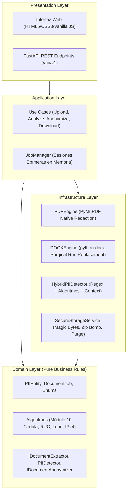

# AnonDoc 🛡️

**Motor Independiente de Detección y Anonimización de Información Personal en Documentos PDF y DOCX.**

AnonDoc es una aplicación web y API REST diseñada para que cualquier persona u organización pueda cargar documentos, identificar automáticamente información personal y sensible (PII), revisar los hallazgos en una interfaz con control humano (*Human-in-the-Loop*) y generar documentos anonimizados de forma irreversible y segura.

---

## 📌 Tabla de Contenidos
1. [Características Principales](#-características-principales)
2. [Arquitectura del Sistema (Clean Architecture)](#-arquitectura-del-sistema)
3. [Motor de Detección Híbrida PII](#-motor-de-detección-híbrida-pii)
4. [Estrategias de Anonimización](#-estrategias-de-anonimización)
5. [Seguridad y Privacidad por Diseño](#-seguridad-y-privacidad-por-diseño)
6. [Requisitos Previos e Instalación](#-requisitos-previos-e-instalación)
7. [Ejecución en Desarrollo](#-ejecución-en-desarrollo)
8. [Ejecución mediante Docker](#-ejecución-mediante-docker)
9. [Especificación de la API REST](#-especificación-de-la-api-rest)
10. [Pruebas Automatizadas](#-pruebas-automatizadas)
11. [Limitaciones Conocidas](#-limitaciones-conocidas)

---

## 🌟 Características Principales

- **Procesamiento 100% Local y Privado:** No envía documentos ni datos a proveedores en la nube o LLMs externos. Todo el análisis se ejecuta en el servidor.
- **Redacción Nativa Irreversible en PDF:** A diferencia de visores que colocan rectángulos negros sobre el texto, AnonDoc utiliza las corrientes de redacción nativas de PyMuPDF, eliminando físicamente los objetos de texto y caracteres del PDF.
- **Anonimización Estructural en DOCX:** Recorre párrafos, tablas, encabezados, pies de página y limpia los metadatos *core* del documento (autores, comentarios, revisiones).
- **Enfoque Human-in-the-Loop:** Interfaz web minimalista y moderna que permite activar/desactivar detecciones, corregir falsos positivos y añadir datos manualmente antes de compilar el archivo definitivo.
- **Múltiples Estrategias:** Soporta Redacción (`[DATO ANONIMIZADO]`), Seudonimización consistente (`PERSONA_001`, `CEDULA_001`) y Enmascaramiento (`u*****@correo.com`, `********05`).

---

## 🏗 Arquitectura del Sistema

AnonDoc está construido bajo los principios de **Clean Architecture**, asegurando que las reglas de negocio y los motores de procesamiento estén completamente desacoplados del framework web:



---

## 🔍 Motor de Detección Híbrida PII

AnonDoc combina tres capas complementarias para garantizar una alta precisión y minimizar falsos positivos:

1. **Reconocimiento de Patrones y Regex:** Identificación de correos, teléfonos, placas, IPs, etc.
2. **Validación Algorítmica Determinista:**
   - **Cédulas Ecuatorianas:** Validación matemática de provincia (01-24, 30), tercer dígito (< 6) y dígito verificador mediante algoritmo módulo 10.
   - **RUC Ecuatoriano:** Validación de personas naturales (10 dígitos + 001), sociedades privadas (tercer dígito 9, módulo 11) e instituciones públicas (tercer dígito 6, módulo 11).
   - **Tarjetas Bancarias:** Validación de tarjetas Visa, Mastercard, Amex, Diners mediante el algoritmo de Luhn.
   - **Direcciones IPv4:** Validación de rangos numéricos de octetos (0-255).
3. **Análisis de Contexto Lingüístico:**
   - Filtro de frases institucionales comunes para evitar clasificar nombres de leyes, entidades públicas o fechas como personas.
   - Detección de títulos personales (`Dr.`, `Ing.`, `Abg.`, `Sr.`, `compareciente`) para elevar la confianza de nombres propios.

### Niveles de Confianza
- **ALTA (`HIGH`):** Superó validación matemática estricta (ej. Cédula válida, email RFC, tarjeta Luhn).
- **MEDIA (`MEDIUM`):** Coincidencia regex con palabras clave de contexto cercanas (ej. "teléfono: 098...").
- **BAJA (`LOW`):** Coincidencia léxica ambigua. Se presenta al usuario para revisión obligatoria y no se anonimiza silenciosamente.

---

## 🎭 Estrategias de Anonimización

| Estrategia | Descripción | Ejemplo de Entrada | Resultado |
| :--- | :--- | :--- | :--- |
| **Redacción** | Sustituye el texto por etiquetas descriptivas fijas o personalizadas. | `0102030405` | `[CEDULA_ANONIMIZADO]` |
| **Seudonimización** | Asigna identificadores consistentes para cada entidad a lo largo del documento. | `Carlos Pérez` ... `Carlos Pérez` | `PERSONA_001` ... `PERSONA_001` |
| **Enmascaramiento** | Oculta parcialmente los datos conservando los últimos dígitos o iniciales. | `juan@empresa.com`<br>`0987654321` | `j***@empresa.com`<br>`******4321` |

---

## 🔒 Seguridad y Privacidad por Diseño

Resumen de controles (detalle, auditoría y riesgos residuales en [SECURITY.md](SECURITY.md)). Ningún control garantiza seguridad absoluta; revise las limitaciones antes de usar documentos reales.

- **Autorización por trabajo:** cada carga devuelve un `job_id` y un `access_token` secreto (se muestra una sola vez). Todos los endpoints del trabajo exigen `Authorization: Bearer <token>`; sin él (o con otro token) la respuesta es 404 indistinguible.
- **Procesamiento aislado:** el parseo y la redacción corren en un subproceso con entorno mínimo, límites de memoria/CPU/tamaño/tiempo y concurrencia acotada.
- **Validación estricta:** firma real del archivo (magic bytes) coherente con la extensión; límites de tamaño, páginas, objetos, entradas ZIP y ratio de descompresión; rechazo de PDFs cifrados o con JavaScript/Launch/XFA/adjuntos activos, y de DOCX con macros, OLE, ActiveX o relaciones externas; XML parseado con `defusedxml` (sin XXE).
- **Fail-closed:** si la verificación posterior no pasa, el resultado **no** se entrega.
- **Minimización:** al anonimizar se borran el original, las entidades y el mapa de seudónimos; los archivos expiran por TTL y se purgan al iniciar/apagar.
- **Sanitización de contenido oculto:** metadatos, anotaciones, adjuntos, miniaturas, comentarios, notas, cuadros de texto y autores.
- **Web:** CSP sin recursos externos, cabeceras de seguridad, CORS cerrado por defecto, docs OpenAPI desactivadas por defecto, límites de tasa y de tamaño de cuerpo, errores genéricos y logs sin PII.
- **Despliegue:** escucha en `127.0.0.1` por defecto; contenedor no root, `read_only`, `cap_drop: ALL`, `no-new-privileges`, tmpfs para temporales.

---

## 📦 Requisitos Previos e Instalación

### Requisitos del Sistema
- **Python:** 3.11 o 3.12.

### Instalación Local
```bash
# 1. Clonar el repositorio
git clone https://github.com/ChaeMendoza/anondoc.git
cd anondoc

# 2. Crear y activar entorno virtual
python3 -m venv .venv
source .venv/bin/activate

# 3. Instalar dependencias
pip install -r requirements.txt
```

---

## 🚀 Ejecución en Desarrollo

Para iniciar la aplicación web y la API REST:
```bash
python -m anondoc.main
```
La aplicación estará disponible de inmediato en:
- **Interfaz Web (Dashboard):** [http://localhost:8000](http://localhost:8000)
- **Documentación OpenAPI:** desactivada por defecto; actívela solo en desarrollo con `ANONDOC_ENABLE_DOCS=true` (`/docs`).

**Motor semántico local (GLiNER, opcional):** por defecto solo se usan las reglas deterministas. Para activar el motor híbrido ejecute con `ANONDOC_ENABLE_GLINER=true` (requiere el paquete `gliner` y el modelo en caché local; use `HF_HUB_OFFLINE=1` para impedir descargas). Si GLiNER está ocupado, falla o no está disponible, el análisis se marca como **parcial** y la interfaz lo advierte.

---

## 🐳 Ejecución mediante Docker

AnonDoc incluye `Dockerfile` y `docker-compose.yml` endurecidos (también compatible con `podman-compose`). El puerto se publica solo en `127.0.0.1:8000`; para exponerlo use un reverse proxy con TLS y autenticación.

```bash
# Construir e iniciar el contenedor
docker compose up -d --build

# Ver logs de la aplicación
docker compose logs -f

# Detener el contenedor
docker compose down
```

---

## 📡 Especificación de la API REST

Todos los endpoints se encuentran versionados bajo el prefijo `/api/v1`. Los endpoints de `{job_id}` requieren `Authorization: Bearer <access_token>`:

| Método | Endpoint | Descripción |
| :--- | :--- | :--- |
| `POST` | `/api/v1/documents` | Carga de archivo PDF o DOCX. Retorna `job_id` y `access_token`. |
| `POST` | `/api/v1/documents/{job_id}/analyze` | Extrae bloques y ejecuta la detección de PII. |
| `GET` | `/api/v1/documents/{job_id}/analysis` | Consulta el listado de entidades detectadas y métricas. |
| `PATCH`| `/api/v1/documents/{job_id}/detections` | Modifica selecciones, descarta falsos positivos o añade entidades. |
| `POST` | `/api/v1/documents/{job_id}/anonymize` | Ejecuta la anonimización física según la estrategia elegida. |
| `GET` | `/api/v1/documents/{job_id}/download` | Descarga el archivo anonimizado final. |
| `DELETE`| `/api/v1/documents/{job_id}` | Elimina el trabajo y destruye los archivos temporales asociados. |
| `GET` | `/api/v1/health` | Estado de salud, trabajos activos y límites de carga (`max_file_size_bytes`, `allowed_extensions`, `semantic_engine_enabled`). |

---

## 🧪 Pruebas Automatizadas

La suite de pruebas incluye tests unitarios para validadores algorítmicos, pruebas de motores documentales con verificación residual y tests de integración end-to-end sobre la API REST:

```bash
PYTHONPATH=. pytest -v
```

Las pruebas de seguridad (`tests/test_security.py`) cubren validación de archivos, ZIP bombs, XXE, macros, IDOR/BOLA, cabeceras, límites de tasa, aislamiento del worker, ReDoS, verificación fail-closed y ausencia de PII residual. Herramientas de análisis: `ruff check anondoc tests`, `bandit -r anondoc`, `pip-audit -r requirements.txt` (`pip install -r requirements-dev.txt`).

---

## ⚠️ Limitaciones Conocidas

1. **PDFs Escaneados:** Si un PDF consiste exclusivamente en imágenes escaneadas sin una capa de texto OCR preexistente, el sistema alertará que la página contiene una imagen sin texto seleccionable.
2. **Textos en Curvas Vectoriales:** Textos convertidos a curvas o trazados vectoriales gráficos (por ejemplo en logotipos de cabecera) no son reconocidos como caracteres de texto por los extractores de flujo.
3. **Imágenes con Texto Incrustado:** AnonDoc anonimiza flujos de texto, metadatos y tablas; no realiza OCR en imágenes fotográficas incrustadas en el cuerpo del documento por defecto para mantener un bajo consumo de memoria.
4. **Aislamiento parcial:** el worker tiene límites de recursos pero no aislamiento de red ni sandbox de syscalls; ver [SECURITY.md](SECURITY.md).
5. **Estado en memoria:** los trabajos viven en un solo proceso; no hay escalado horizontal ni persistencia.
