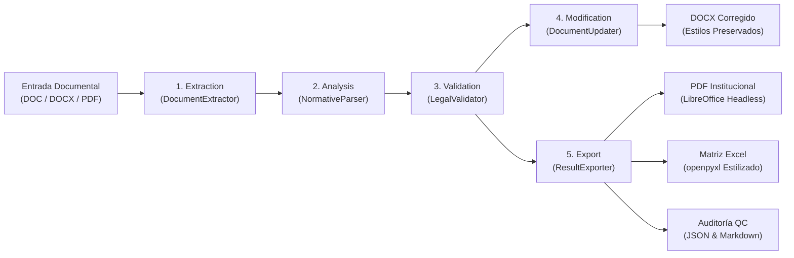

# Sistema de Auditoría y Corrección Normativa - Defensoría del Pueblo del Ecuador (DPE)

Sistema en Python diseñado para procesar, auditar y corregir informes técnico-jurídicos emitidos sobre proyectos de ley tramitados en la Asamblea Nacional del Ecuador.

Este caso de uso específico aborda el **Proyecto de Ley Orgánica de Fomento a la Alimentación Saludable y al Consumo de Proteína de Alto Valor Biológico**, corrigiendo valoraciones genéricas en la sección de conclusiones y asegurando la preservación de la potestad técnica de la Autoridad Sanitaria Nacional (Ministerio de Salud Pública - MSP) conforme a los Arts. 13, 32 y 215 de la Constitución de la República del Ecuador (CRE).

---

## 📌 Tabla de Contenidos
1. [Arquitectura y Diseño Técnico](#-arquitectura-y-diseño-técnico)
2. [Requisitos Previos](#-requisitos-previos)
3. [Instalación Rápida](#-instalación-rápida)
4. [Guía de Pruebas y Ejecución](#-guía-de-pruebas-y-ejecución)
5. [Estructura del Código](#-estructura-del-código)
6. [Flujo de Procesamiento Interno](#-flujo-de-procesamiento-interno)
7. [Salidas Generadas (Artifacts)](#-salidas-generadas-artifacts)
8. [Roadmap y Puntos de Extensión para Developers](#-roadmap-y-puntos-de-extensión-para-developers)

---

## 🏗 Arquitectura y Diseño Técnico

El sistema sigue principios de diseño limpio (**Clean Architecture / Single Responsibility Principle**), dividiendo el flujo en cinco etapas independientes:



### Principios Clave
- **Inmutabilidad y Preservación de Estilos:** Se leen los documentos originales y se aplican modificaciones quirúrgicas sobre el árbol XML del documento Word preservando tipografías, jerarquías de títulos, colores institucionales y tablas.
- **Trazabilidad Jurídica:** Cada propuesta de cambio está respaldada por una cita explícita a la norma o documento fuente (Arts. 6 y 8 del Proyecto, Arts. 13, 32 y 215 de la CRE).
- **Human-in-the-Loop:** Ningún cambio se marca como jurídicamente validado sin firma humana; por defecto quedan en estado `PENDIENTE DE REVISIÓN TÉCNICA`.

---

## ⚙️ Requisitos Previos

- **Python 3.11 o superior** (Probado y certificado en Python 3.12.3).
- **LibreOffice headless** (`libreoffice` o `soffice`): Necesario en el sistema operativo para:
  - Conversión automatizada de archivos legados `.doc` a `.docx`.
  - Conversión vectorial del `.docx` corregido final a `.pdf`.

En sistemas basados en Debian/Ubuntu:
```bash
sudo apt-get update && sudo apt-get install -y libreoffice
```

---

## 🚀 Instalación Rápida

1. Clonar el repositorio y posicionarse en la carpeta raíz:
   ```bash
   cd experimento
   ```

2. Crear y activar el entorno virtual de Python:
   ```bash
   python3 -m venv .venv
   source .venv/bin/activate
   ```

3. Instalar las dependencias:
   ```bash
   pip install -r requirements.txt
   ```

---

## 🧪 Guía de Pruebas y Ejecución

### Paso 1: Generar los documentos de prueba oficiales
El repositorio incluye un generador sintético pero fidedigno (`create_sample_documents.py`) que crea tres archivos institucionales en `sample_input/`:
- `proyecto_de_ley.docx`: Contiene el articulado del proyecto legislativo (Art. 6 y Art. 8).
- `informe_dpe_original.docx`: Informe de la Defensoría del Pueblo que incluye la 5ta conclusión original con la frase problemática: *«podría obstaculizar el ejercicio efectivo del derecho a la salud»*.
- `observaciones_institucionales.docx`: Matriz técnica de observaciones de la institución.

Ejecútalo con:
```bash
python create_sample_documents.py
```

### Paso 2: Ejecutar el Pipeline mediante CLI
Ejecuta el procesamiento completo indicando las tres fuentes y la carpeta de salida:
```bash
python -m normativa_dpe.cli \
  --proyecto sample_input/proyecto_de_ley.docx \
  --informe sample_input/informe_dpe_original.docx \
  --observaciones sample_input/observaciones_institucionales.docx \
  --output output
```

### Paso 3: Ejecutar la suite de pruebas automatizadas
Para comprobar que todos los componentes unitarios e integrales funcionan:
```bash
PYTHONPATH=. pytest -v
```

---

## 📂 Estructura del Código

| Módulo / Archivo | Responsabilidad Principal |
| :--- | :--- |
| [`normativa_dpe/models.py`](file:///home/chae/Projects/experimento/normativa_dpe/models.py) | Clases de dominio tipadas (`ChangeRecord`, `ExtractedDocument`, `QualityControlReport`, `ValidationStatus`). |
| [`normativa_dpe/extraction/extractor.py`](file:///home/chae/Projects/experimento/normativa_dpe/extraction/extractor.py) | Extracción de DOCX/DOC/PDF conservando párrafos, niveles de encabezado y tablas con `python-docx` y `pymupdf`. Puente headless para `.doc`. |
| [`normativa_dpe/analysis/parser.py`](file:///home/chae/Projects/experimento/normativa_dpe/analysis/parser.py) | Motor de búsqueda de Art. 6, Art. 8 y de la Conclusión Quinta en el informe. Lógica de sustitución de afirmaciones subjetivas. |
| [`normativa_dpe/validation/legal_rules.py`](file:///home/chae/Projects/experimento/normativa_dpe/validation/legal_rules.py) | Reglas de rigor constitucional ecuatoriano: verifica que no se inventen normas, que se preserve la competencia del MSP y se incorpore el enfoque de DDHH. |
| [`normativa_dpe/modification/document_updater.py`](file:///home/chae/Projects/experimento/normativa_dpe/modification/document_updater.py) | Modificador en memoria del documento Word (.docx) que reemplaza párrafos y runs manteniendo tipografía, negritas, interlineado y colores. |
| [`normativa_dpe/export/exporter.py`](file:///home/chae/Projects/experimento/normativa_dpe/export/exporter.py) | Exportación a Word, PDF, Matriz Excel de control de cambios (`openpyxl` con estilos formales) y reporte QC en Markdown y JSON. |
| [`normativa_dpe/pipeline.py`](file:///home/chae/Projects/experimento/normativa_dpe/pipeline.py) | Orquestador principal que une las 5 etapas del flujo de trabajo. |
| [`normativa_dpe/cli.py`](file:///home/chae/Projects/experimento/normativa_dpe/cli.py) | CLI con argumentos `--proyecto`, `--informe`, `--observaciones` y `--output`. |

---

## 🔍 Flujo de Procesamiento Interno

### 1. Revisión Específica del Artículo 8
- **Problema detectado en la norma:** El proyecto pretende que la ley fije como prioritaria la *proteína de alto valor biológico*, invadiendo la potestad técnica y epidemiológica del MSP.
- **Acción del sistema:** Compara la disposición con las observaciones institucionales e inyecta la recomendación técnica obligatoria:
  > *"Se recomienda que el artículo 8 preserve la facultad de la autoridad sanitaria nacional para actualizar las recomendaciones sobre los grupos de alimentos según la evidencia disponible, la etapa de vida, la diversidad cultural y las condiciones de acceso de la población."*

### 2. Corrección de la Conclusión Quinta
- **Frase original rechazada:** *«podría obstaculizar el ejercicio efectivo del derecho a la salud»* (afirmación abstracta que carece de precisión y sustento empírico para la DPE).
- **Nueva redacción generada:**
  - Preserva la potestad técnica privativa del MSP para definir las guías alimentarias.
  - Prohíbe jerarquías nutricionales invariables en la ley.
  - Incorpora principios de igualdad, no discriminación y pertinencia cultural/territorial.
  - Incluye disponibilidad y accesibilidad económica (Art. 13 CRE).
  - Vincula la garantía con el derecho a la **orientación nutricional individualizada** previsto en el **artículo 6**.

---

## 📦 Salidas Generadas (Artifacts)

Al correr el pipeline, el directorio `output/` contiene:

1. `informe_analisis_normativo_corregido.docx`: Documento Word con el informe corregido y el formato institucional intacto.
2. `informe_analisis_normativo_corregido.pdf`: Versión PDF institucional generada vectorialmente con LibreOffice.
3. `matriz_cambios_normativos.xlsx`: Matriz en Excel con 6 columnas requeridas:
   - `Ubicación`
   - `Texto Original`
   - `Observación`
   - `Justificación`
   - `Propuesta de Redacción`
   - `Estado de Validación` (destacado condicionalmente en naranja para revisión humana).
4. `reporte_control_calidad.md` y `control_calidad.json`: Auditoría que certifica la trazabilidad documental del 100% y la eliminación de valoraciones genéricas.

---

## 🔮 Roadmap y Puntos de Extensión para Developers

Si deseas escalar este aplicativo hacia una plataforma de producción institucional, te recomendamos las siguientes áreas de extensión:

### 1. Migración del Motor de Análisis a LLMs con Salida Estructurada
- Actualmente `NormativeParser` utiliza heurísticas y expresiones regulares deterministas.
- **Mejora:** Integrar un LLM (ej. Gemini 1.5 Pro o modelos locales vía Ollama/vLLM) utilizando Pydantic / JsonSchema (`instructor` o `outlines`) para extraer y categorizar automáticamente cualquier artículo sin necesidad de regex predefinidas.

### 2. Base de Conocimiento Normativo (RAG Especializado)
- Crear un índice vectorial (ChromaDB / Qdrant / pgvector) con el texto del **Registro Oficial del Ecuador**, la **Constitución**, la **Ley Orgánica de Salud**, el **Código Orgánico Administrativo (COA)** y tratados internacionales de derechos humanos (PIDESC, Protocolo de San Salvador).
- Esto permitirá contrastar cualquier observación contra precedentes de la Corte Constitucional del Ecuador de forma instantánea.

### 3. API Web Asíncrona (FastAPI + Celery/Redis)
- Envolver `NormativeReviewPipeline` en una API REST con endpoints:
  - `POST /api/v1/reviews`: Carga multipart de los documentos y encolado de tarea asíncrona.
  - `GET /api/v1/reviews/{task_id}`: Estado del procesamiento y descarga de artefactos generados.

### 4. UI Interactiva para Human-in-the-Loop (Next.js o Streamlit)
- Implementar una interfaz visual que muestre un *diff* lado a lado (*side-by-side*):
  - Izquierda: Párrafo original observado del informe.
  - Centro: Propuesta de cambio con su justificación constitucional.
  - Derecha: Botón para que el abogado o especialista de la Defensoría apruebe, edite o rechace la propuesta antes de compilar el DOCX/PDF definitivo.

### 5. Control de Cambios en Word (Track Changes XML)
- Extender `DocumentUpdater` para que, en lugar de reemplazar directamente el texto, inserte los tags de Word `w:del` (eliminación tachada) y `w:ins` (inserción subrayada con autoría institucional), permitiendo a los abogados ver las marcas de control de cambios nativas de Microsoft Word.
